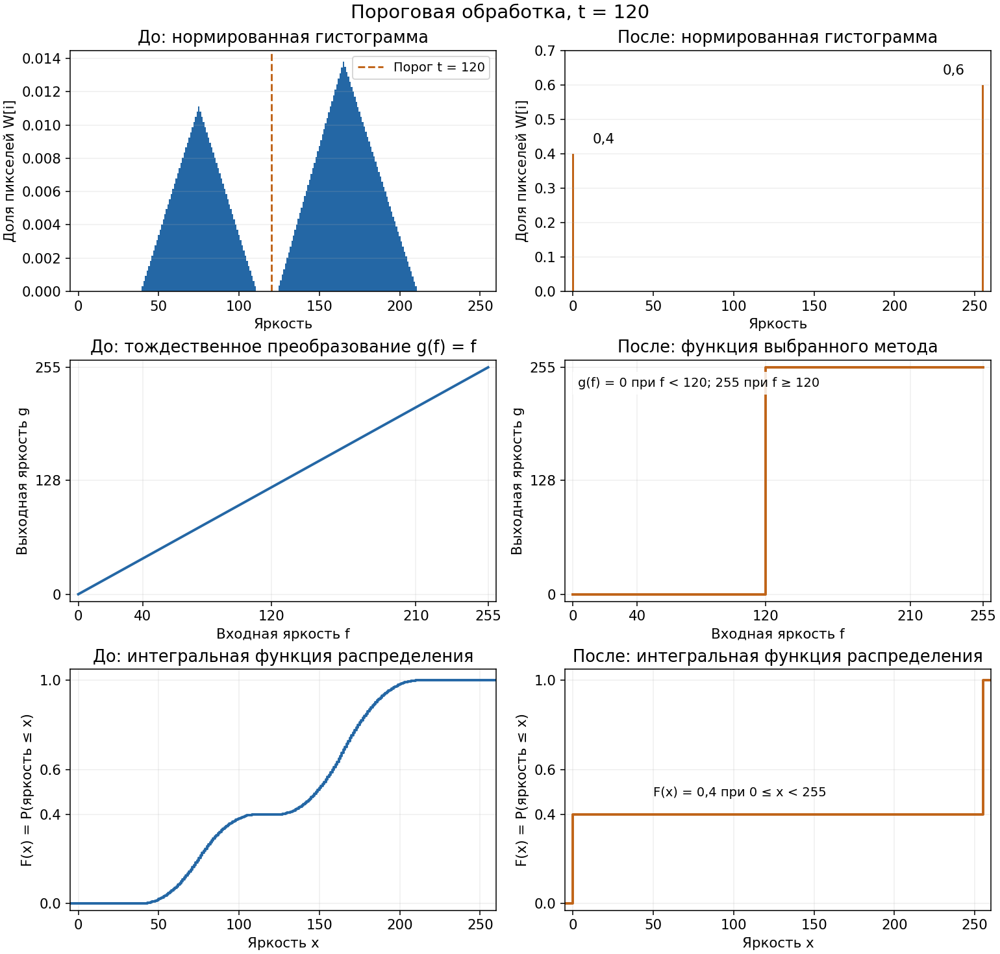
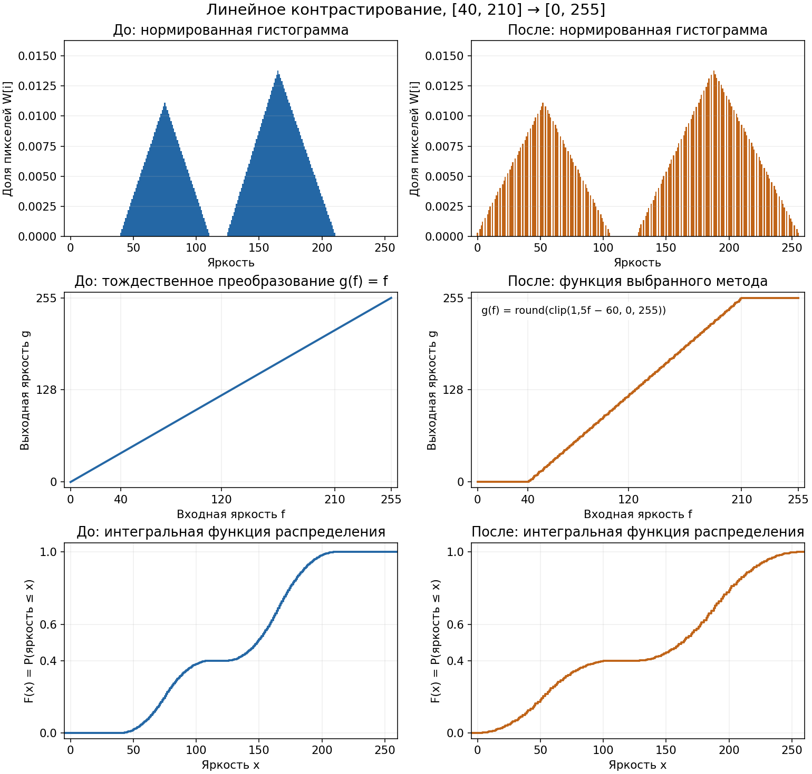
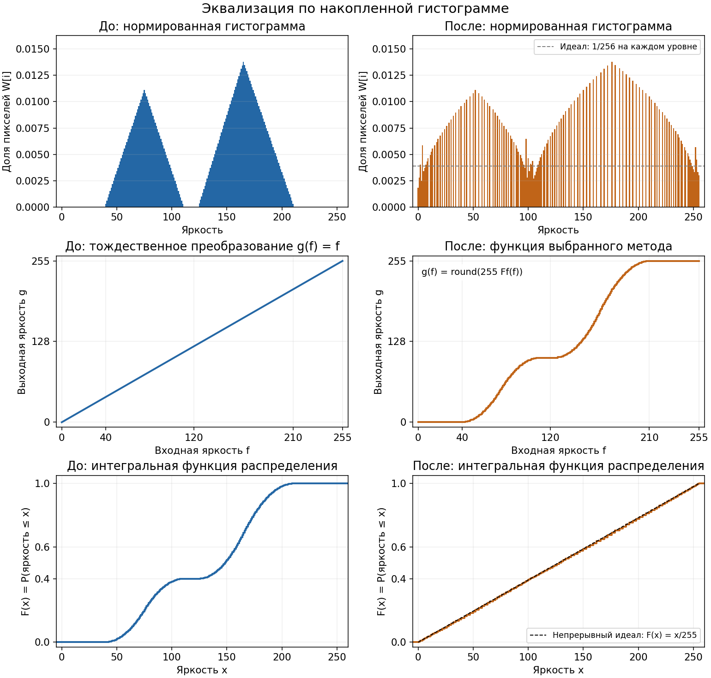

# Ответы на контрольные вопросы к Л.Р. №1 «Поэлементные преобразования изображений»

Ответы построены по разделу 1 методички (СГАУ, 2006); нумерация формул соответствует методичке.

---

## 1. Гистограмма: нормированная и не нормированная, размерность и размер массива

**Не нормированная (абсолютная) гистограмма.** Каждый элемент массива — *число пикселей* изображения, имеющих данную яркость. Единица измерения — пиксели:

$$h[i] = n_i = \#\{ f(m,n) = i \}, \qquad \sum_{i=0}^{Q-1} h[i] = M \times N$$

где $M \times N$ — размер изображения, $Q$ — число уровней квантования яркости. Сумма всех элементов заведомо равна числу пикселей изображения.

**Нормированная гистограмма** — частость (доля) пикселей каждой яркости:

$$W[i] = \frac{n_i}{MN}$$

Каждый элемент — безразмерное число от 0 до 1, являющееся *оценкой вероятности* встретить яркость $i$ у случайно выбранного пикселя. Для дискретных уровней это распределение вероятностей, а не непрерывная плотность. Для оценки непрерывной плотности частость интервала дополнительно делят на его ширину; при ширине 1 численные значения совпадают. Сумма всех элементов нормированной гистограммы равна 1:

$$\sum_{i=0}^{Q-1} W[i] = 1$$

Нормированная гистограмма имеет **тот же размер и ту же форму**, что и абсолютная, — отличается только масштабом оси Y (доли вместо числа пикселей).

**Размерность (мерность) массива гистограммы полутонового изображения — 1 (одномерный).** Гистограмма описывает распределение *значений яркости*, а не их положение на плоскости: изображение $M \times N$ сворачивается в один длинный массив отсчётов, и вся пространственная информация теряется. Поэтому для полутонового изображения любого размера (512×512 или 300×400) гистограмма — одномерный вектор. Для RGB можно строить три отдельные одномерные гистограммы каналов; также существует совместная трёхмерная гистограмма цветов, но в этой работе она не используется.

**Размер массива** определяется числом уровней квантования яркости, т.е. разрядностью представления:
- 8-битное полутоновое изображение — **256 элементов** (уровни 0…255);
- 12/16-битный датчик — 4096 / 65536 элементов;
- бинарное изображение — достаточно 2 элементов; при использовании общей 256-уровневой шкалы 0…255 массив по-прежнему содержит 256 элементов, но ненулевых столбцов не более двух.

Это размер массива при одном интервале на каждый допустимый уровень. В общем случае число интервалов задаётся при построении гистограммы. Массив частот `hist` при 256 интервалах содержит 256 элементов, а массив границ `bins` — 257.

Стандартный способ получения:

```python
hist, bins = np.histogram(img, bins=256, range=(0, 256))   # hist[i] — число пикселей с яркостью i
```

---

## 2. Линейное контрастирование и пороговая обработка

### 2.0. Общая схема поэлементного преобразования (п. 1.1 методички)

Все рассматриваемые преобразования — **пространственно-инвариантные поэлементные**: одно и то же функциональное преобразование применяется к каждому элементу независимо от его положения и значений соседних элементов:

$$g = g(f) \quad (1)$$

Размеры входного и выходного изображений совпадают. Преобразование можно вычислять непосредственно по формуле либо реализовать **таблично (LUT)**: значение яркости $f$ используется как адрес (номер строки) таблицы, из которой берётся выходное значение $g$; для 8-битного изображения полная таблица содержит 256 строк. Преимущества LUT — быстродействие и гибкость. Полная таблица точно задаёт преобразование всех 256 входных уровней; погрешность относительно непрерывной модели связана с квантованием входа и выхода, а при неполной таблице — ещё и с приближением функции. График функции преобразования строится в осях «вход $f$ — выход $g$».

**Влияние квантования (рис. 1 методички).** На участках с малой производной после округления возможно **слияние квантованных уровней** (разным $f$ соответствует один $g$); где производная велика — расстояние между выходными уровнями увеличивается и усиливается влияние ошибки квантования входа. Детерминированное поэлементное преобразование не увеличивает число различных яркостей изображения: оно сохраняется при взаимно однозначном отображении используемых уровней или уменьшается при их слиянии и насыщении.

### 2.1. Линейное контрастирование (п. 1.2)

**Формула (2) методички:**

$$g = a f + b, \qquad a = \frac{g_{max}-g_{min}}{f_{max}-f_{min}}, \qquad b = g_{min} - a f_{min}$$

при шкале $[g_{min}, g_{max}] = [0, 255]$:

$$a = \frac{255}{f_{max} - f_{min}}, \qquad b = -a f_{min}$$

где $f_{min}, f_{max}$ — минимальная и максимальная яркости изображения. Преобразование «растягивает» реальный динамический диапазон $[f_{min}, f_{max}]$ малоконтрастного изображения на всю шкалу $[0, 255]$. При полном диапазоне $f_{min}=0, f_{max}=255$ получаем $a=1, b=0$ — тождественное преобразование.

**График функции преобразования** — отрезок прямой, проходящий через точки $(f_{min}, 0)$ и $(f_{max}, 255)$; для входов вне диапазона — горизонтальные полки на уровнях $g_{min}=0$ и $g_{max}=255$ (срезка):

```
255 |                          ______    ← полка 255 (f > fmax)
    |                         /
    |                       /    g = clip(a·(f − fmin), 0, 255)
    |                     /
  0 |_____________ _____/
          0    fmin        fmax      f
```

**Построение функции исходя из гистограммы.** По гистограмме (или напрямую по массиву) определяются $f_{min}$ и $f_{max}$ — положения крайних ненулевых столбцов распределения яркости; далее параметры $a, b$ вычисляются по формуле выше и строится таблица из 256 значений:

```python
lut = np.clip(np.rint(a * (np.arange(256) - fmin)), 0, 255).astype(np.uint8)
```

Вариант с доверительными границами строится так же, но $f'_{min}, f'_{max}$ берутся не как истинные экстремумы, а как квантили распределения (п. 3, рис. 2в методички).

**Изменение гистограммы после контрастирования.** В непрерывной модели без обрезки преобразование $g=af+b$, $a>0$, растягивает распределение по горизонтали в $a$ раз и сдвигает его; плотность изменяется по формуле $W_g(g)=W_f((g-b)/a)/a$. Общая форма сохраняется с учётом этих масштабов. У цифрового изображения частоты переносятся на соответствующие выходные уровни, поэтому округление и насыщение могут менять вид гистограммы. Характерные последствия:

- минимальная и максимальная используемые яркости переходят в 0 и 255; это не означает заполнения каждого промежуточного уровня;
- между столбцами появляются **пустые градации («гребёнка»)** — след растяжения: производная $a>1$ увеличивает расстояние между используемыми уровнями (рис. 1 методички);
- если использовались доверительные границы, по краям (0 и 255) появляются высокие пики — срезанные маловероятные выбросы (см. п. 3);
- при растяжении min/max в ту же 8-битную шкалу $a\ge1$, поэтому разные используемые целочисленные уровни не сливаются от округления; слияние возможно при сжатии шкалы ($a<1$) или при насыщении хвостов в варианте с квантилями.

### 2.2. Пороговая обработка (п. 1.4)

**Смысл.** Перевод полутонового изображения (много градаций) в бинарное (двухградационное): сократить информационную избыточность, оставив только нужные детали (объекты) и отбросив несущественное (фон). Все элементы делятся на два класса по признаку яркости:

$$g = \begin{cases} g_{max}, & f \ge f_0 \\ g_{min}, & f < f_0 \end{cases}$$

где $f_0$ — пороговое значение яркости (при шкале $[0,255]$: $g_{max}=255$, $g_{min}=0$).

**График функции преобразования** — «ступенька»: 0 слева от $f_0$, 255 справа:

```
255 |                _______ ______
    |                |
  0 |_______ _______|
          0         f0         255    f
```

**Выбор порога исходя из гистограммы.** В идеале (объекты одной яркости на фоне другой) плотность распределения — две дельта-функции; тогда порогом служит любое значение между пиками. На практике из-за шума и разброса яркостей пики «расплываются». Если сохраняются две различимые моды, порог $f_0$ можно выбрать в **минимуме (провале) между ними** (рис. 4 методички). Это практическое правило, а не гарантия минимальной ошибки классификации: оптимальный порог зависит от распределений классов, их долей и стоимости ошибок. Если гистограмма унимодальная или изрезанная многомодальная, требуются специальные методики (вне данной работы).

**Гистограмма после пороговой обработки** вырождается в **два столбца**: один на уровне 0 (тёмный класс), второй — на 255 (светлый). Высоты столбцов пропорциональны долям пикселей, попавших в каждый класс. Вся информация о промежуточных яркостях теряется.

---

## 3. Выбор параметров линейного контрастирования: min/max, среднее/дисперсия, квантиль

### По минимуму и максимуму

$$a = \frac{255}{f_{max}-f_{min}}, \qquad b = -a f_{min}$$

Растяжение выполняется строго по фактическому диапазону: хвосты распределения не обрезаются, хотя сами яркости изменяются. При почти полном диапазоне эффект слабый; строго нулевой он при $[f_{min}, f_{max}]=[0,255]$. Если $f_{min}=f_{max}$, изображение постоянно и формула с делением неприменима: нужно отдельно задать поведение, например оставить изображение без изменения.

### По среднему и дисперсии

Задаются *желаемые* среднее $\mu^*$ и СКО $\sigma^*$ (например, $\mu^* = 128$, $\sigma^* = 64$) и берутся параметры

$$a = \frac{\sigma^*}{\sigma}, \qquad b = \mu^* - a \mu \quad\Rightarrow\quad g = \mu^* + (f - \mu)\frac{\sigma^*}{\sigma}$$

где $\mu, \sigma$ — среднее и СКО яркостей исходного изображения. Если заданы дисперсии $D$ и $D^*$, то $a=\sqrt{D^*/D}$. Так разброс масштабируется до выбранного СКО, а среднее переносится в $\mu^*$. В непрерывной модели без обрезки форма распределения сохраняется с изменением центра и ширины. После округления и обрезки фактические среднее и дисперсия могут отличаться от заданных. При $\sigma=0$ формула неприменима; при большом $\sigma^*/\sigma$ возможен выход за шкалу и потеря деталей из-за насыщения.

### По квантилю гистограммы (доверительные границы, рис. 2в методички)

Вместо истинных экстремумов назначаются границы $f'_{min}, f'_{max}$ **по квантилям распределения**: например, 2-й и 98-й перцентили задают центральную область примерно для 96% пикселей. Это интервал яркостей по квантилям, а не статистический доверительный интервал оценки параметра:

```python
fmin_r = int(np.percentile(img, 2))    # нижняя граница по 2-му перцентилю
fmax_r = int(np.percentile(img, 98))   # верхняя граница по 98-му перцентилю
a_r = 255.0 / (fmax_r - fmin_r)
```

Если выбранный интервал строго уже фактического диапазона и его границы различны, то $a'>a$ — **эффект контрастирования сильнее**. Из-за повторяющихся яркостей границы могут совпасть с экстремумами или друг с другом; во втором случае нужно отдельно обработать нулевую ширину интервала.

**Возможные искажения яркости.** Пиксели, лежащие за выбранными границами, после линейного преобразования выходят за шкалу и ограничиваются значениями $g_{min}$ или $g_{max}$. То есть:

- пиксели «хвостов» распределения **безвозвратно срезаются** в 0 или 255; при границах 2%/98% доли хвостов ориентировочно равны 2%, но не обязаны быть точно такими из-за совпадающих яркостей, интерполяции перцентилей и округления границ;
- редкие тени и блики превращаются в чисто чёрные/белые области, детали в них теряются («пробитые» света и тени);
- на гистограмме появляются характерные **пики-аккумуляторы** на краях шкалы (0 и 255);
- доля пикселей за выбранным интервалом равна суммарной массе срезанных хвостов. Чем уже интервал, тем больше риск потери деталей; заметность потерь зависит от содержания изображения, а не только от процента отсечённых пикселей.

Плата за более сильный эффект — необратимое искажение крайних яркостей.

---

## 4. Плотность распределения яркости W(x) и интегральная функция распределения F(x)

**Связь через интеграл (п. 1.3 методички).** Плотность распределения яркости $W(x)$ и интегральная функция распределения $F(x)$ связаны:

$$F(x) = \int_{-\infty}^{x} W(f)\,df, \qquad W(x) = \frac{dF(x)}{dx}$$

$F$ — интеграл плотности (накопленная вероятность), $W$ — производная $F$ там, где она существует. Свойства: $F$ монотонно не убывает, $F(-\infty)=0$, $F(+\infty)=1$. В методичке формула (3) записана через $P[f<f_0]$; для непрерывной модели это равно $P[f\le f_0]$. Для цифровых яркостей далее используем соглашение:

$$P[f \le f_0] = F(f_0).$$

**Связь оценок через сумму.** На цифровом изображении $W$ и $F$ оцениваются по гистограмме ($n_i$ — число пикселей яркости $i$, $N$ — общее число пикселей):

$$\widehat W[i] = \frac{n_i}{N}, \qquad \widehat F(x) = \sum_{i\le x}\widehat W[i] = \frac{1}{N}\sum_{i=0}^{\lfloor x\rfloor}n_i, \qquad 0\le x\le255.$$

Для эмпирического распределения это точные равенства; относительно неизвестного распределения источника изображения — оценки. В дискретном случае обратная связь задаётся разностью: $\widehat W[i]=\widehat F(i)-\widehat F(i-1)$, где $\widehat F(-1)=0$.

Интеграл заменяется конечной суммой по интервалам гистограммы: значение $F$ на уровне $x$ — накопленная (кумулятивная) сумма нормированной гистограммы, «интегральная гистограмма». В коде:

```python
F = np.cumsum(W)      # W — нормированная гистограмма (сумма элементов = 1)
```

**Кумулятивная сумма.** Кумулятивная (накопленная) сумма — массив, каждый элемент которого равен сумме всех предыдущих элементов исходного массива и его самого:

$$S[k] = \sum_{i=0}^{k} A[i]$$

Пример для короткого массива:

```python
>>> np.cumsum([3, 1, 2])
array([3, 4, 6])        # S[0]=3;  S[1]=3+1=4;  S[2]=3+1+2=6
```

Пример на нормированной гистограмме из 4 уровней $W = [0.2,\ 0.3,\ 0.1,\ 0.4]$:

$$F = \mathrm{cumsum}(W) = [0.2,\ 0.5,\ 0.6,\ 1.0]$$

— получена накоплением долей: интегральная функция распределения яркости.

---

## 5. Вероятностный смысл W(50) и F(50)

**Непрерывная модель: W(50) — плотность, а не вероятность.** Вероятность отдельного значения $P[f=50]=0$. Вероятность попадания в малый интервал около 50 приближённо равна произведению плотности на ширину интервала:

$$P[x_1 \le f \le x_2] = \int_{x_1}^{x_2} W(f)\,df \approx W(50)\,\Delta x \ \ \text{при малом } \Delta x$$

т.е. $W(50)$ задаёт высоту кривой плотности в точке 50, а **вероятность** в окрестности точки 50 — это *площадь узкой полосы* под кривой шириной $\Delta x$ вокруг неё. В дискретном 8-битном случае величина $W(50)$ совпадает с вероятностью конкретного уровня: $W(50) = n_{50}/N$ — доля пикселей изображения, имеющих яркость ровно 50 (значение столбца гистограммы на уровне 50).

**F(50) — накопленная вероятность.** $F(50)$ — вероятность того, что яркость случайно выбранного пикселя **не превысит 50**:

$$P[f \le 50] = F(50) = \int_{-\infty}^{50} W(f)\,df$$

— доля пикселей с яркостью не выше 50 (числовой пример в каждом случае даёт собственная гистограмма).

**Площади.** Геометрически: $F(50)$ — **площадь под кривой плотности $W$, заключённая слева от точки 50**; вероятность попадания в диапазон $[x_1, x_2]$ равна площади между $x_1$ и $x_2$:

$$P[x_1 \le f \le x_2] = F(x_2) - F(x_1) \qquad\text{(непрерывная модель)}.$$

Для целочисленных яркостей и целых границ нужно включить левый край: $P[x_1\le f\le x_2]=F(x_2)-F(x_1-1)$. В частности, $W[50]=F(50)-F(49)$ — доля пикселей яркости ровно 50, а $F(50)=\sum_{i=0}^{50}W[i]$. На нормированной гистограмме с единичной шириной интервалов это площадь столбца уровня 50 и суммарная площадь столбцов уровней 0…50 соответственно.

Полная площадь под кривой $W$ от $-\infty$ до $+\infty$ равна 1.

---

## 6. Эквализация: формула, плотность и интегральная функция (идеальный случай) до/после

**Формула преобразования (п. 1.3 методички).** Требуется распределение яркостей, равномерное на шкале $[g_{min}, g_{max}]$:

$$W_g(g) = \frac{1}{g_{max}-g_{min}}, \qquad F_g(g) = \int_{g_{min}}^{g} W_g(h)\,dh = \frac{g - g_{min}}{g_{max}-g_{min}} \ \text{— линейная}$$

Пусть $g = g(f)$ — монотонно возрастающая функция. Тогда события $f \le f_0$ и $g \le g(f_0)$ жёстко связаны (одно — следствие другого), их вероятности равны; приравнивая (3) и (4) методички:

$$F_f(f) = F_g\big(g(f)\big) \quad (5)$$

Подставляя линейное $F_g$ и разрешая относительно $g$:

$$g(f) = (g_{max}-g_{min})\,F(f) + g_{min} \ \xrightarrow[\ g_{min}=0,\ g_{max}=255\ ]{}\ \boxed{\,g(f) = 255\,F(f)\,}$$

где $F(f)$ — интегральная функция распределения яркости **исходного** изображения. На практике таблица строится по п. 1.3 методички: гистограмма → нормировка → накопленная сумма (кумулятивная) → таблица $g[i] = \operatorname{round}(255\,\widehat F[i])$.

**До эквализации.** $W(f)$ — произвольная плотность (у малоконтрастного изображения — сосредоточенная в узкой части шкалы), $F(f)$ — соответствующая ей монотонная кривая (типично S-образная).

**После эквализации (идеальный непрерывный случай).** Плотность яркости становится равномерной на всей шкале, а интегральная функция — прямой:

$$W_{new}(g) = \frac{1}{255} = \text{const}, \qquad F_{new}(g) = \int_0^g \frac{dh}{255} = \frac{g}{255} \ \text{— прямая линия}$$

**Практическое замечание.** Равномерность гарантируется преобразованием через CDF в идеальной непрерывной модели. В цифровом изображении все пиксели одного входного уровня переходят в один выходной уровень, поэтому крупный пик нельзя разделить между несколькими уровнями. Выходная гистограмма может содержать пропуски и сильные пики; она не обязана стать менее изрезанной. Ступенчатая выходная CDF часто приближается к линейной, но качество такого приближения зависит от исходного распределения. Для идеально равномерных **256 дискретных уровней** вероятности равны $1/256$, а $F[k]=(k+1)/256$; это отличается от непрерывных формул $1/255$ и $g/255$.

Стандартная реализация может использовать другую нормировку CDF, например вычитать первую ненулевую накопленную вероятность. Поэтому совпадение с `cv2.equalizeHist` не обязано быть точным и не является самостоятельным доказательством формулы; в работе сравниваются результаты двух соглашений.

---

## Приложение. Как нарисовать гистограмму и функцию преобразования на защите

Ниже приведены **теоретические схемы**, не результаты обработки `boat.tif`.
В качестве примера взято распределение с двумя группами яркостей: тёмной и светлой.
Для другого исходного распределения рисунок изменится, но правила построения останутся теми же.

Для каждого метода показаны шесть графиков:

1. **Нормированная гистограмма до обработки** — доли пикселей исходных яркостей.
2. **Нормированная гистограмма после обработки** — доли пикселей выходных яркостей.
3. **Функция преобразования до обработки** — тождественная функция $g(f)=f$: яркости ещё не изменены.
4. **Функция преобразования после обработки** — таблица $g(f)$ выбранного метода, связывающая исходную яркость с итоговой.
5. **Интегральная функция распределения до обработки** — $F_f(x)=\sum_{i\le x}W_f[i]$.
6. **Интегральная функция распределения после обработки** — $F_g(x)=\sum_{j\le x}W_g[j]$.

Сумма 256 элементов каждой нормированной гистограммы равна 1. Пример дискретный: частоты переносятся точно по LUT, с округлением выходных яркостей. Поэтому после растяжения и эквализации видны пропуски между используемыми уровнями. На графике эквализации пунктиром отмечен идеал равномерного дискретного распределения $1/256$; точного совпадения с ним поэлементное преобразование обычно не даёт. Средний ряд показывает функции преобразования, нижний — интегральные функции распределения. У $g(f)$ по вертикали яркость 0…255, у $F(x)$ — накопленная вероятность 0…1. Связь исходной и выходной яркости задаёт правая функция $g(f)$; левая диагональ служит исходным состоянием для сравнения.

### Пороговая обработка: два столбца и ступенька



**Интегральная функция после порога.** В этом примере $F_g(x)=0$ при $x<0$, $F_g(x)=0{,}4$ при $0\le x<255$ и $F_g(x)=1$ при $x\ge255$. Получаются два скачка: в 0 и 255. Это накопленные вероятности, а не ступенька функции преобразования с порогом 120.

**Что рисовать.** На исходной гистограмме отмечаем порог $t$. На графике $g(f)$ рисуем горизонталь $g=0$ при $f<t$ и горизонталь $g=255$ при $f\ge t$. В выходной гистограмме остаются только уровни 0 и 255. Высоты определяются не высотами исходных пиков, а **суммами частот по обе стороны порога**:

$$h_g[0]=\sum_{i<t}h_f[i],\qquad h_g[255]=\sum_{i\ge t}h_f[i].$$

На схеме слева от порога лежит 40% пикселей, справа — 60%, поэтому нормированные выходные столбцы имеют высоты 0,4 и 0,6. Для абсолютной гистограммы их высоты равны $0{,}4MN$ и $0{,}6MN$.

**Если преподаватель изменит порог.** При движении $t$ вправо ступенька сдвигается вправо, число чёрных пикселей не убывает, белых — не возрастает. При движении влево — наоборот. Если порог движется по пустому промежутку исходной гистограммы, число чёрных и белых пикселей не меняется. При обратном правиле, когда светлым становится класс $f<t$, ступенька убывает, а высоты выходных столбцов меняются местами.

### Линейное контрастирование: растяжение распределения и наклонная прямая



**Интегральная функция после контрастирования.** В непрерывной модели без насыщения $F_g(x)=F_f((x-b)/a)$, $a>0$: форма накопленной кривой растягивается по оси яркости, а значения остаются в пределах 0…1. Прямой она становиться не обязана. На схеме CDF рассчитана по дискретной выходной гистограмме с учётом округления.

**Что рисовать.** Находим крайние используемые яркости $f_{min}$ и $f_{max}$; проводим прямую через $(f_{min},0)$ и $(f_{max},255)$. Вне этого интервала рисуем полки 0 и 255. На схеме $f_{min}=40$, $f_{max}=210$, поэтому $g=1{,}5f-60$ внутри рабочего интервала. Распределение растягивается по оси яркости до всей шкалы.

В непрерывной модели при растяжении в $a$ раз плотность становится ниже в $a$ раз, чтобы площадь осталась равной 1. **У дискретной гистограммы это не означает деления каждого столбца на $a$:** при взаимно однозначном переносе его число пикселей сохраняется, меняется положение столбца, между уровнями могут появиться пропуски.

**Если преподаватель изменит параметры.**

- Чем уже исходный рабочий интервал, тем круче прямая и сильнее растяжение. При $f_{min}=0$, $f_{max}=255$ получаем диагональ $g=f$ и неизменную гистограмму.
- Увеличение $b$ при неизменном $a$ поднимает график $g(f)$ и сдвигает распределение к светлым яркостям; уменьшение $b$ — к тёмным. Выход за шкалу приводит к насыщению.
- При $0<a<1$ рабочий диапазон сжимается; после округления соседние уровни могут сливаться и их частоты складываются.
- Если границы выбраны по квантилям внутри фактического диапазона, прямая становится круче, но хвосты попадают на полки: слева накапливаются пиксели яркости 0, справа — 255. На выходной гистограмме появляются крайние пики, а различия яркостей внутри отсечённых хвостов теряются.

### Эквализация: накопленная гистограмма задаёт форму преобразования



**Что должно выпрямляться при эквализации.** В идеальной непрерывной модели выходная $F_g(x)$ становится наклонной прямой $x/255$, а выходная $W_g$ — горизонтальной линией. На нижнем правом графике идеальная CDF отмечена пунктиром. Функция преобразования $g(f)=255F_f(f)$ в среднем правом графике остаётся нелинейной: она строится по исходной CDF и обеспечивает выравнивание распределения.

**Что рисовать.** По исходной гистограмме мысленно накапливаем площадь слева направо. Получаем неубывающую $F_f(f)$ от 0 до 1; умножая её на 255, рисуем $g(f)=255F_f(f)$. В идеальном непрерывном случае выходная плотность — горизонталь $1/255$ на интервале $[0,255]$, а выходная интегральная функция — диагональ $F_g(g)=g/255$.

Главная связь для рисунка:

$$\frac{dg(f)}{df}=255W_f(f).$$

**Если преподаватель изменит исходную гистограмму.** Высокому пику соответствует крутой участок функции преобразования; редким яркостям — пологий, пустому интервалу — горизонтальный. Два пика дают два участка быстрого роста, разделённые более пологой частью или площадкой. Поэтому функция эквализации не обязательно имеет одну S-образную форму. Если исходное непрерывное распределение уже равномерно на $[0,255]$, то $F_f(f)=f/255$, функция преобразования — диагональ $g=f$, распределение не меняется.

**Для цифрового изображения.** Вместо идеально гладкой функции получается неубывающая таблица, а выходная гистограмма может остаться с пропусками и пиками. Нельзя делить исходный столбец между несколькими выходными уровнями: вся его частота переносится на уровень, заданный LUT. Поэтому на защите нужно различать идеальную непрерывную схему и точное преобразование дискретных частот.

### Общее правило для любой заданной гистограммы

Для каждого исходного уровня $i$ находим выход $j=\mathrm{LUT}[i]$ и переносим туда весь столбец. Если несколько исходных уровней попали в один выходной, их частоты складываются:

$$h_g[j]=\sum_{i:\,\mathrm{LUT}[i]=j}h_f[i].$$

Например, если в уровнях 40 и 41 было 10 и 15 пикселей, а преобразование отправляет оба уровня в 0, то они добавят в выходной столбец 0 суммарно 25 пикселей. Если уровни отправлены в 60 и 62, сохранятся столбцы высотой 10 и 15, а уровень 61 не получит пикселей от этих двух столбцов. Это правило позволяет нарисовать результат любого из трёх методов по заданным исходным частотам и функции преобразования.
